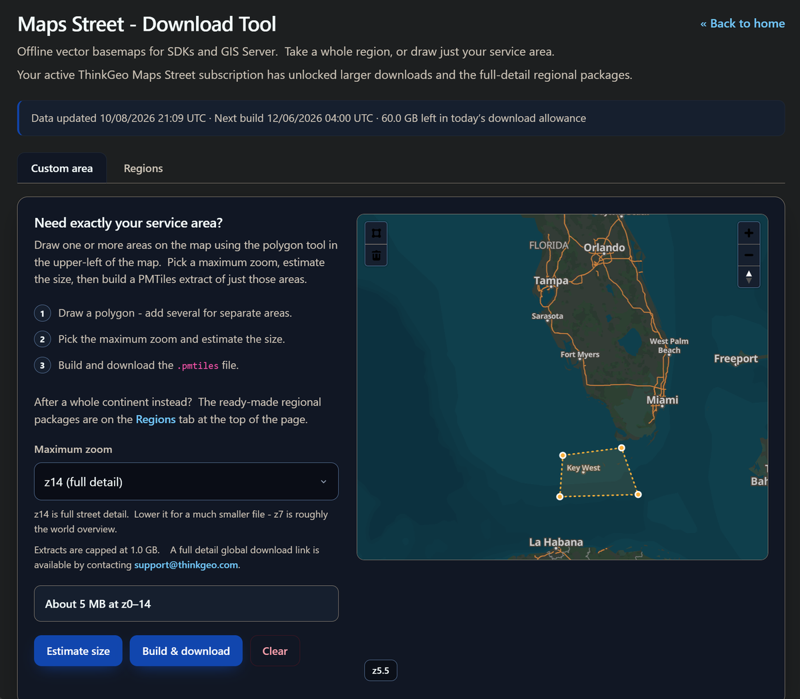

# ThinkGeo Maps Street: download your own area

ThinkGeo Maps Street data now comes as **PMTiles**, and you cut the area you need online, in the ThinkGeo HelpDesk. You don't need a tool on your machine for it any more.

The desktop MbTiles Extractor in this folder worked on the older `.mbtiles` downloads. It is no longer maintained.



## Download your area

1. Sign in at [helpdesk.thinkgeo.com](https://helpdesk.thinkgeo.com) with the account that holds your ThinkGeo Maps Street subscription.
2. Open the **Maps Street - Download Tool**: [helpdesk.thinkgeo.com/maps-street-download](https://helpdesk.thinkgeo.com/maps-street-download).
3. On the **Custom area** tab, choose the polygon tool in the upper-left of the map and draw your area. Draw more than one polygon for separate areas.
4. Pick the **Maximum zoom**:
   - **z14** is full street detail;
   - a lower zoom gives a much smaller file; **z7** is roughly the world overview.
5. Click **Estimate size** to see how large the file will be.
6. Click **Build & download** to get a `.pmtiles` file of just your areas.

To get a whole continent, use the **Regions** tab instead: it has ready-made regional packages.

The bar at the top of the page shows:
- when the data was last updated;
- when the next monthly build runs;
- how much of today's download allowance is left.

## Limits

- **With an active Maps Street subscription:**
  - each extract can be up to **1 GB**;
  - the full-detail regional packages are available;
  - the page shows your daily allowance.
- **Without a subscription:** small trial extracts only, at most **5 MB** each and **150 MB** in total.
- For a full-detail global file, contact [support@thinkgeo.com](mailto:support@thinkgeo.com).
- To buy Maps Street, see [thinkgeo.com/mapping-data](https://thinkgeo.com/mapping-data).

## Use the file in your application

ThinkGeo opens PMTiles directly, with no network:

```csharp
var tiles = new PmTilesVectorTileSource(@"C:\Data\my-area.pmtiles");
```

The WPF HowDoI sample **Your Data > Offline Tiles** ([OfflineTiles.xaml.cs](../../samples/wpf/HowDoISample/Samples/YourData/OfflineTiles.xaml.cs)) shows a PMTiles archive drawn on a map.

## Getting help

- [ThinkGeo Community Site](https://community.thinkgeo.com/)
- [ThinkGeo Web Site](https://www.thinkgeo.com)
